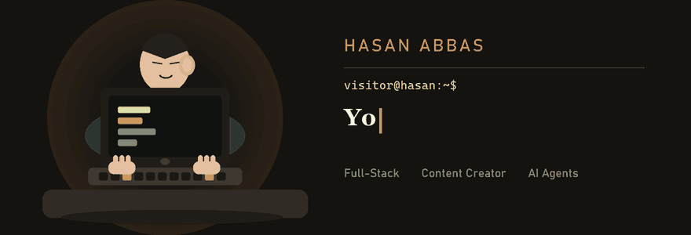

  

---

For contact and to follow me, here.

  
  &nbsp;
  
  &nbsp;
  
  &nbsp;
  

---

## About Me

I am a final-year Computer Science student at the University of Bahrain, and I am close to completing a Higher Diploma at Reboot01, a coding institute in Bahrain. I have delivered frontend and backend projects, and my strongest work is on the backend. I focus on automation and on AI agents that follow a set of instructions and carry the work through on their own. I am currently building applications around those systems, so more everyday tasks can be handled without constant manual effort. I use AI as a normal part of how I develop, then I review the result myself. I do not treat generated output as finished until the project is accurate and carefully made.

---

<table>
  <tr>
    <td width="58%" valign="top">

### Workflows and AI agents

These are not programming tools and they are not design tools. They run workflows and AI agents on their own, from instructions.

<table>
  <tr>
    <td align="center">
       
      n8n
    </td>
    <td align="center">
       
      Hermes Agent
    </td>
    <td align="center">
       
      Grok
    </td>
  </tr>
</table>

    </td>
    <td width="42%" valign="top">

### API platform

OpenRouter is the platform I use to get the API keys for my projects.

<table>
  <tr>
    <td align="center">
       
      OpenRouter
    </td>
  </tr>
</table>

    </td>
  </tr>
</table>

---

## Tools

### AI coding

Editors and coding agents I use to write and review code.

<table>
  <tr>
    <td align="center"> Codex</td>
    <td align="center"> Claude Code</td>
    <td align="center"> Cursor</td>
    <td align="center"> OpenCode</td>
  </tr>
</table>

### Creation

Tools I use to make visual work.

<table>
  <tr>
    <td align="center"> Higgsfield</td>
    <td align="center"> Blender</td>
  </tr>
</table>

### Design

Where I design an interface before I build it.

<table>
  <tr>
    <td align="center"> Figma</td>
  </tr>
</table>

### Build and ship

Where I store data, test requests, and publish projects.

<table>
  <tr>
    <td align="center"> Supabase</td>
    <td align="center"> Hostinger</td>
    <td align="center"> GitHub</td>
    <td align="center"> Postman</td>
  </tr>
</table>

---

## Frameworks

The frameworks I build with, and the language each one comes from.

<table>
  <tr>
    <td align="center"> <b>React</b> JavaScript</td>
    <td align="center"> <b>Next.js</b> JavaScript</td>
    <td align="center"> <b>Vue</b> JavaScript</td>
    <td align="center"> <b>Express</b> JavaScript</td>
    <td align="center"> <b>Bootstrap</b> CSS</td>
  </tr>
</table>

---

## Skills

### Languages

The languages I use to write the core of a program. Node.js is the runtime for the JavaScript services.

<table>
  <tr>
    <td align="center"> Java</td>
    <td align="center"> JavaScript</td>
    <td align="center"> TypeScript</td>
    <td align="center"> Go</td>
    <td align="center"> Rust</td>
    <td align="center"> Node.js</td>
  </tr>
</table>

### Interface

HTML for structure, CSS for how the screen looks.

<table>
  <tr>
    <td align="center"> HTML</td>
    <td align="center"> CSS</td>
  </tr>
</table>

### Data

MySQL and SQLite store the data. GraphQL is how some of my projects query it.

<table>
  <tr>
    <td align="center"> MySQL</td>
    <td align="center"> SQLite</td>
    <td align="center"> GraphQL</td>
  </tr>
</table>

### APIs

REST is the interface a client uses to talk to a service.

<table>
  <tr>
    <td align="center"> REST APIs</td>
  </tr>
</table>

### Systems

Docker packages a service. Git keeps the history of the work.

<table>
  <tr>
    <td align="center"> Docker</td>
    <td align="center"> Git</td>
  </tr>
</table>

### Practice

Automation and AI agents are the work I am building toward: systems that act from instructions.

<table>
  <tr>
    <td align="center"> Automation</td>
    <td align="center"> AI Agents</td>
  </tr>
</table>
