

  

&nbsp;

&nbsp;
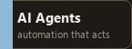

  

If you want to build something together, or just say hello, you can reach me here.

  

&nbsp;

&nbsp;

&nbsp;

 

[hasanjami2004@gmail.com](mailto:hasanjami2004@gmail.com)

## About

I am a final-year Computer Science student at the University of Bahrain, and a higher-diploma student at Reboot01. I am close to graduating from both.

I build on the frontend and the backend, and I prefer the backend. Public work so far includes a social network in Go and Next.js, a GraphQL student dashboard, a Rust traffic simulation, and a realtime multiplayer game. The work I care about most is automation and AI agents: applications that take on a task and carry it through.

I use AI as a daily part of building, then I review the output and correct it until the project is solid. I also write and make short videos, so an idea can live in a product or in a story.

## Tools

The software I actually work in. Each box opens its site.

### AI coding

Where I write, review, and run agents.

### Making and design

Workflows, motion, 3D, and interface design.

### Shipping

Where a project is stored, hosted, tested, and published. Postman is how I check an API before it ships.

## Skills

Grouped by the job they do.

### Languages

The languages I write software in.

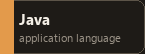
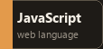
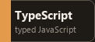
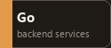
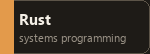

### Interface

Structure, style, and the screens people use.

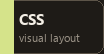

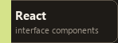
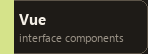
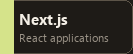

### Backend and data

Storage, APIs, servers, and live connections. SQL here means MySQL and SQLite. REST is the API style I build against.

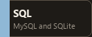

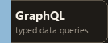

### Delivery

How a project is packaged, and how its history stays intact.

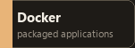
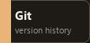

### AI practice

Agents and automations that carry a task through.

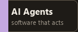
